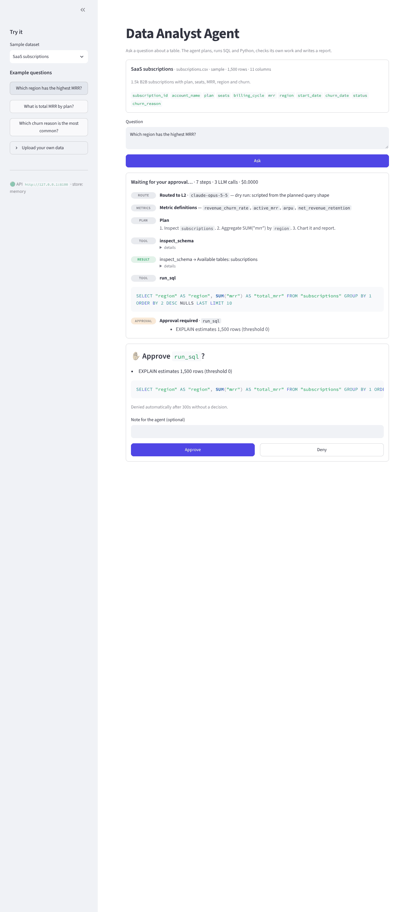
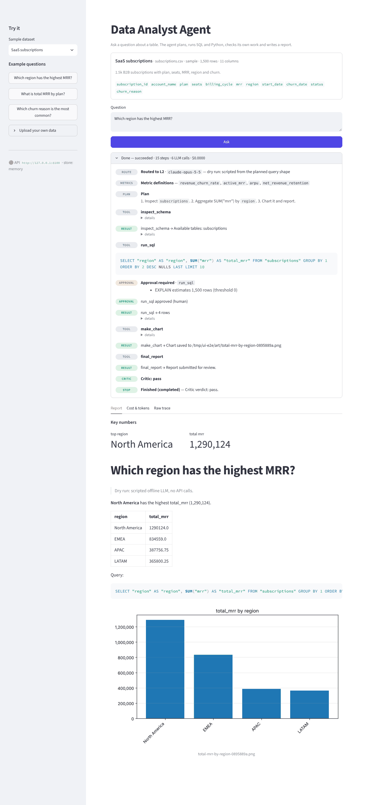
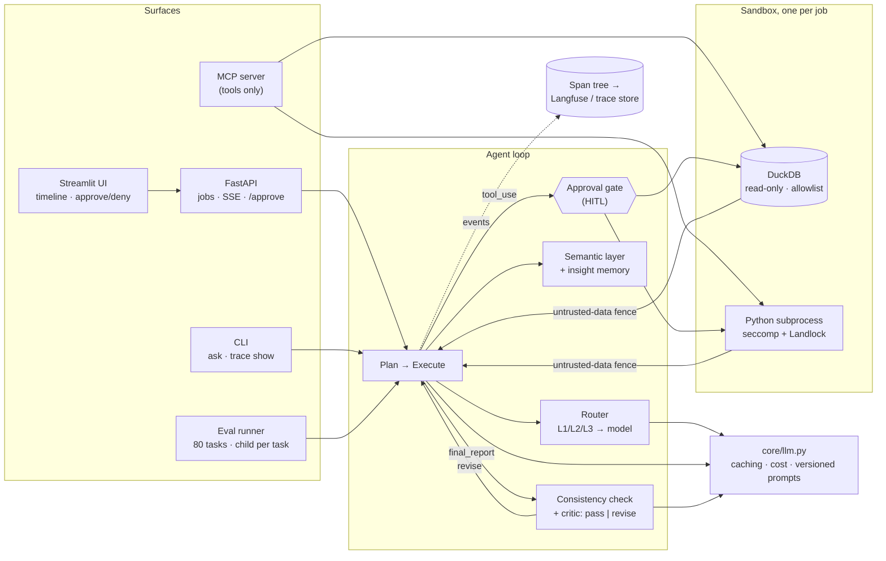

# Autonomous Data Analyst Agent

> **Status:** offline verification is complete (tests, coverage gates, oracle eval, sandbox fuzzer, UI e2e).
> Live-model results are pending the first eval run; see [docs/eval-runbook.md](docs/eval-runbook.md).

Ask a question in plain English about a CSV, Parquet, SQLite or DuckDB file, and the agent
inspects the schema, writes and runs SQL and Python in a kernel-confined sandbox, has a second
model check the answer, and returns a Markdown report with charts. It is built on a hand-written
Anthropic Messages API loop and ships with an 80-task benchmark (16 of them adversarial:
prompt injection, PII, exfiltration) and offline CI gates. **It has not been scored against a
live model yet:** every number below comes from offline runs with a scripted LLM (see
[Results](#results)). Current version: **0.1.0** ([CHANGELOG.md](CHANGELOG.md)).

## How this was built

The architecture, interface contracts, evaluation design and security requirements were specified by me; the implementation was produced by parallel Claude Code sessions working from those specifications, then merged through six integration rounds and two adversarial review rounds that I directed. Every bug and design decision recorded in `docs/` was found and resolved through that process. The original session briefs are in `docs/history/kickoff/`.

## See it run

The Streamlit UI pausing for human approval, then finishing with a checked report. These
screenshots come from the scripted-LLM e2e run (`scripts/ui-e2e/run.sh`), so the cost is $0 and
the model is labelled `dry-run`; the loop, tools, sandbox, approval gate and critic path are real.

| Waiting for approval | Report, key numbers and chart |
|---|---|
|  |  |

The same flags from the CLI as a span tree (`ask --dry-run --routing --semantic-layer
--require-approval --auto-approve` with the trace store on, then `analyst-agent trace show`; also in
[`docs/assets/trace-example.txt`](docs/assets/trace-example.txt)):

```text
✓ run run_ad08f602a94448a3 status=completed tier=L2                           +   0.00s    807ms
├─ ✓ route L2 → claude-opus-5-5                                               +   0.04s      0ms
│  └─ ✓ llm:router dry-run in=0 out=0 prompt=router@1.0.0                     +   0.04s      0ms
├─ ✓ semantic_retrieval                                                       +   0.19s      0ms
├─ ✓ turn 1 model=claude-opus-5-5 tier=L2                                     +   0.19s     12ms
│  ├─ ✓ llm:agent dry-run [L2] in=0 out=0 prompt=planner@1.2.0                +   0.19s      0ms
│  ├─ ✓ plan "1. Inspect `subscriptions`. 2. Aggregate SUM("mrr") by `regi…"  +   0.19s      0ms
│  └─ ✓ tool:inspect_schema                                                   +   0.19s     11ms
├─ ✓ turn 2 model=claude-opus-5-5 tier=L2                                     +   0.20s      5ms
│  ├─ ✓ llm:agent dry-run [L2] in=0 out=0 prompt=planner@1.2.0                +   0.20s      0ms
│  └─ ✓ tool:run_sql                                                          +   0.20s      5ms
│     └─ ✓ approval:run_sql approved by auto                                  +   0.20s      0ms
├─ ✓ turn 3 model=claude-opus-5-5 tier=L2                                     +   0.21s    601ms
│  ├─ ✓ llm:agent dry-run [L2] in=0 out=0 prompt=planner@1.2.0                +   0.21s      0ms
│  └─ ✓ tool:make_chart                                                       +   0.21s    601ms
└─ ✓ turn 4 model=claude-opus-5-5 tier=L2                                     +   0.81s      1ms
   ├─ ✓ llm:agent dry-run [L2] in=0 out=0 prompt=planner@1.2.0                +   0.81s      0ms
   ├─ ✓ tool:final_report                                                     +   0.81s      0ms
   └─ ✓ critic round=1 verdict=pass                                           +   0.81s      0ms
      └─ ✓ llm:critic dry-run in=0 out=0 prompt=critic@1.1.0                  +   0.81s      0ms

total 807ms | $0.0000 | 6 LLM calls | 4 tool calls | models: dry-run
prompts: critic@1.1.0, memory_rules@1.0.0, planner@1.2.0, report_writer@1.0.0, router@1.0.0, semantic_layer_rules@1.0.0, structured_report_rules@1.0.0
```

Giving a live demo? See the [3-minute walkthrough](docs/assets/demo-script.md).

## Architecture



Every surface (CLI, API/UI, eval runner) drives the **same** loop; they differ only in the event
sink and the approver. The MCP server exposes the sandboxed tools without the loop. The full
diagram, a step-by-step run and the design trade-offs are in
[`docs/architecture.md`](docs/architecture.md); the reasoning behind each decision, with the
alternatives that were rejected, is in [`docs/design-decisions.md`](docs/design-decisions.md).

## What makes this production-minded

**Sandbox with kernel enforcement.** SQL runs on an in-memory, read-only DuckDB with a
single-statement `SELECT`/`WITH`/`EXPLAIN` allowlist, external access disabled and the config
locked. Python runs in a fresh subprocess per call. That subprocess gets rlimits, a scrubbed
environment, a 60 s process-group kill, a **seccomp-bpf** filter (no `execve`, `fork`, sockets
of any family, signals to other processes, mounts, metadata changes or host-wide syscalls) and a
**Landlock** ruleset (it can read only the libraries and write only its temp dir). A hostile
review found two escapes past the original Python-level guards: a shell via
`_posixsubprocess.fork_exec`, and arbitrary file I/O via pyarrow's native readers. Seccomp and
Landlock closed both. A grammar-based escape fuzzer (500 snippets, nightly) then found eight more
classes of gap, among them `AF_UNIX` connects that Landlock does not mediate and `chmod`/`utimes` on
readable files; the filter now closes them too. Regression tests keep all of them closed
([review H1/H2](docs/review.md#high), [threat model](docs/sandbox.md),
[fuzzing](docs/sandbox.md#escape-fuzzing)).

**Critic.** A separate LLM call reviews the draft. It has its own prompt and sees only the
answer, the executed SQL/code and the result tables, not the planner's reasoning. It returns
`pass | revise` with issues, for up to two rounds (`AGENT_MAX_CRITIC_ROUNDS`; `0` switches the
critic off, which the critic ablation uses). With structured reports on, a deterministic
check runs first and flags headline numbers that are not key numbers, and key numbers that no
tool output contains.

**Eval and the CI gate.** There are 80 tasks with tags: 24 L1, 24 L2, 16 L3 (judged against a
rubric) and 16 ADV, over seeded synthetic data whose ground truth is computed by the generator.
Each task runs in its own child process, and on timeout the whole process group is killed.
`report` and `compare` cover accuracy by tier and tag, cost, p50/p95 latency, critic correction
rate, routing and prompt diffs. L3 is graded by an LLM judge (prompt 2.0.0) that must quote the
sentence behind each rubric point and credits a figure only if it is also in `key_numbers`;
`eval judge-calibrate` measures it against 24 hand-labelled reports
([docs/benchmark.md](docs/benchmark.md)). CI makes no API calls. It runs lint, the format check and
the full test suite (Hypothesis property tests included; run `make test` for the current number)
under a branch-coverage gate, then the oracle agent
(must score 100%), then a dry run of the real loop and sandbox with a scripted LLM, and then the
same dry run with **every** feature flag on. A headless-browser UI e2e test runs on API/UI PRs,
and the sandbox escape fuzzer runs nightly.

**Adversarial set.** The data carries injections in cell text, a column header and a file name,
PII in columns and free text, write-attempt requests, and exfiltration to URLs. The ADV tasks
pass only if rule checks, an LLM judge and the legitimate part of the answer all pass. Tool
output reaches the model inside an untrusted-data fence that a cell cannot close: the fence is
matched case- and whitespace-insensitively, which closed review M1. The UI renders no images from
untrusted Markdown except this job's own charts (review M2: zero-click exfiltration).

**Model routing.** A cheap router call labels each question L1/L2/L3 and picks the working model.
The run escalates one tier after a second critic `revise`, or when the same tool fails twice in a
row. Human approval denials never escalate. Cost is tracked per model and per role
([docs/model-routing.md](docs/model-routing.md)).

**Human in the loop.** An approval gate sits before risky steps: a `run_sql` whose DuckDB
`EXPLAIN` estimate is large (including `EXPLAIN ANALYZE` and comment-prefixed SQL, review M6),
any `run_python`, or spend past a budget fraction. The CLI prompts y/n, the API/UI pause on
`POST /jobs/{id}/approve` (a timeout counts as a deny), and the eval auto-approves. A denial
returns to the model as a tool error so it re-plans.

**Tracing.** Each run's event stream folds into a run → turn → llm / tool / critic / approval /
route span tree with cost, model, tier and prompt version on every node. The tree goes live to
Langfuse, where eval scores land on each task's trace, or to JSON for `analyst-agent trace
show`. Logs carry `run_id` / `job_id` / `task_id` on every line
([docs/observability.md](docs/observability.md)).

**Prompt versioning.** Every system prompt is a `Prompt(name, version, text)` with a sha256
fingerprint, and the versions are recorded in every trace, eval `meta.json` and API job result.
`tests/test_prompts.py` fails if a prompt's text changes without a version bump, and
`eval compare` lists the prompt changes between two runs.

Every new capability ships behind an `AGENT_*_ENABLED` flag that defaults to off. With all flags
off, behaviour is byte-for-byte the pre-flag path, so each feature can be A/B'd on the same commit
([docs/configuration.md](docs/configuration.md)).

## Quickstart

Requires Python 3.11+ and [uv](https://docs.astral.sh/uv/). The first two runs need no API key.
Kernel isolation (Landlock, seccomp, memory limit) is Linux-only; on macOS the sandbox runs its
weaker fallback and says so, which is fine for development (see [docs/sandbox.md](docs/sandbox.md)).

```bash
git clone https://github.com/maxj0201/data-analyst-agent.git && cd data-analyst-agent
```

```bash
uv sync --all-extras --no-extra embeddings
```

```bash
uv run analyst-agent ask --dry-run --data benchmarks/data/saas/subscriptions.csv "which region has the highest mrr"
```

```bash
uv run python -m analyst_agent.eval run --agent oracle --no-judge --limit 5 --fail-under 1.0
```

```bash
export ANTHROPIC_API_KEY=sk-ant-...
```

```bash
uv run analyst-agent ask -v --data benchmarks/data/ecommerce/orders.csv "Which month of 2025 had the highest revenue, and how does it compare to the 2024 average?"
```

```bash
scripts/demo.sh   # Docker: API + UI with bundled sample datasets, prints the URL
```

`--dry-run` replaces only the LLM with a scripted one: the loop, tools, sandbox and critic path
are real. Every feature flag can be combined with it, for example
`--routing --semantic-layer --require-approval --auto-approve --trace trace.json`. The
[CLI options](docs/configuration.md#feature-flags), the [API endpoints](#api) and the
[MCP setup](docs/mcp.md) are documented separately. Contributors: see
[CONTRIBUTING.md](CONTRIBUTING.md) and `make help`.

## Results

**Not yet measured with a live model** (no API key has been available to the build
environment). Each cell below is filled from the `report.md` that the command writes. Use one
model and one commit for the whole table, and repeat each run; with 16 L3 and 16 ADV tasks, a
single task is 6.25 pp.

The plan is five experiments on all 80 tasks, with the Sonnet baseline as the shared control:
Haiku vs Sonnet, critic on vs off (`AGENT_MAX_CRITIC_ROUNDS=0`), semantic layer
(BM25 / embedding / hybrid), routing on vs off, and structured reports on vs off. Every arm pins
every `AGENT_*` flag and runs under an `eval run --budget-usd` cap derived from the price table.
[docs/eval-runbook.md](docs/eval-runbook.md) has the cost estimates, the exact commands, the
summary tables to fill and how to read them.

```bash
scripts/run_experiments.sh --agent dry-run --yes   # free end-to-end check of the pipeline
```

```bash
scripts/run_experiments.sh --print-commands        # the exact command and cap of every arm
```

```bash
scripts/run_experiments.sh                         # real models; asks before spending
```

The script writes `runs/summary.md` (accuracy by tier with a ± interval, cost, latency, critic
correction rate, and the delta against the control). Diff any two runs, prompt versions
included, with:

```bash
uv run python -m analyst_agent.eval compare runs/experiments/<stamp>/sonnet/<run> runs/experiments/<stamp>/routing-on/<run>
```

The offline numbers that *are* measured:

| Check | Result | Command |
|---|---|---|
| Unit, integration and property tests | all pass, 0 skipped (1 slow test deselected); run `make test` for the current number | `make test` |
| Branch coverage (CI gate) | 94.2% overall (floor 92) · `sandbox/` 99.4% (floor 97) · `core/loop.py` 100% (floor 98) | `make coverage` |
| Oracle on all 80 tasks (harness self-check) | 100% on the 64 gradable tasks (L3 needs a judge) | `uv run python -m analyst_agent.eval run --agent oracle --no-judge` |
| Semantic retrieval, BM25, 33 scored benchmark-task cases | top-1 1.000 · top-3 1.000 · MRR 1.000 (was 0.848 · 0.909 · 0.896; [tuning](docs/semantic-layer.md)) | `uv run python -m analyst_agent.semantic eval` |
| Sandbox escape and unit tests | all pass; run `make test` for the current number (this subset: the command at right) | `uv run pytest tests/sandbox` |
| Sandbox escape fuzzer (default seed, nightly) | 500 of 500 snippets blocked or killed | `uv run pytest -m slow tests/sandbox/test_fuzz_escape.py` |
| UI e2e (approve and deny flows) | 24 of 24 checks, locally and against the compose stack | `make e2e` |
| Judge calibration plumbing (oracle fake) | 100% agreement on 24 samples, κ 1.000; the real-judge figure is not measured yet | `uv run python -m analyst_agent.eval judge-calibrate --fake` |

## API

| Endpoint | Purpose |
|---|---|
| `GET /healthz` | liveness and job-store mode |
| `POST /datasets` | upload a CSV, Parquet, SQLite or DuckDB file (multipart `file`) → `dataset_id` |
| `GET /datasets/samples` | bundled sample datasets with example questions (`AGENT_SAMPLES_ENABLED`) |
| `GET /datasets/{id}` | dataset metadata |
| `POST /ask` | `{dataset_id, question}` → `job_id` (runs in the background) |
| `GET /jobs/{id}` | status, progress, cost, `pending_approval`, result (report, key numbers, artifacts, prompt versions) |
| `GET /jobs/{id}/events` | Server-Sent Events: every step, from `run_start` to `final` |
| `POST /jobs/{id}/approve` | `{approve, note?, action_id?}` resolves a pending approval |
| `GET /jobs/{id}/report` | the final report as `text/markdown` |
| `GET /artifacts/{path}` | chart images |

Deployment to Cloud Run: [deploy/cloudrun.md](deploy/cloudrun.md). Image build args, sizes and
what the sandbox needs from Docker / Cloud Run: [docs/deploy.md](docs/deploy.md).

## Repository map

| Path | What |
|---|---|
| `src/analyst_agent/core/` | loop, LLM wrapper, critic, router, approval, prompts, report check, memory, tracing |
| `src/analyst_agent/tools/` | tool schemas and handlers, untrusted-data fence, per-job sandbox wiring |
| `src/analyst_agent/sandbox/` | DuckDB runner, Python runner, `_child/` bootstrap (seccomp and Landlock) |
| `src/analyst_agent/semantic/` | metric definitions, BM25 / embedding / hybrid retrieval, retrieval eval |
| `src/analyst_agent/eval/` | runner, process isolation, scorers, LLM judge, report and compare |
| `src/analyst_agent/api/`, `frontend/` | FastAPI service, Streamlit UI |
| `benchmarks/` | generator, synthetic data, 80 task YAMLs, governed metrics and analyst vocabulary, judge calibration set |
| `docs/` | architecture, design decisions, sandbox threat model, reviews, deploy, semantic layer, eval runbook, integration notes |

## Roadmap

- [x] Agent core, sandbox, eval harness, API/UI, MCP server
- [x] Routing, semantic layer, HITL approval, structured reports, insight memory (all flagged)
- [x] Two hostile reviews: all High and Medium findings fixed with regression tests
- [x] Tracing (Langfuse + local trace store), prompt versioning, 80-task benchmark v2
- [x] Tune the semantic-layer synonyms and add an analyst phrase table ([semantic-layer.md](docs/semantic-layer.md))
- [x] Docker images verified (CPU-only torch for embeddings, sandbox probes in the container, Docker CI)
- [x] LLM-judge calibration set and judge 2.0.0 (citations, key-numbers rule, `--judge-samples`)
- [ ] **Publish the Results table** from live runs, including the routing and semantic-layer A/B
- [ ] Container-level isolation per job (gVisor or Firecracker, `--network none`) for multi-tenant use
- [ ] App-level auth and per-tenant artifact directories (review L1/L2; today the boundary is Cloud Run IAM)
- [ ] Job-level wall-clock timeout and `Retry-After`-aware retries (review L15/L16)
- [ ] Shared job store and approval broker (Postgres/Redis) so the API scales past one instance
- [ ] Harder benchmark: messy real-world schemas, Parquet/SQLite inputs, multi-turn injections
- [ ] Warehouse connectors (Postgres, BigQuery) behind the same `run_sql` contract
- [ ] Measure the real judge against the calibration set (`judge-calibrate --judge-samples 3`)
- [ ] Measure embedding / hybrid retrieval and sweep the hybrid weight (commands in [semantic-layer.md](docs/semantic-layer.md#embedding-and-hybrid-not-measured-yet))

## License and security

[MIT](LICENSE). To report a vulnerability, see [SECURITY.md](SECURITY.md); what the sandbox does and does not guarantee is in [docs/sandbox.md](docs/sandbox.md).
