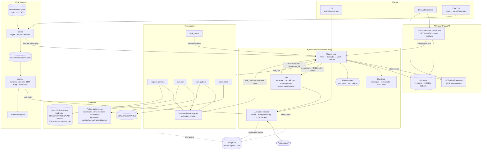

# Autonomous Data Analyst Agent

A Python agent that answers natural-language questions over tabular data by inspecting the schema
and executing SQL/Python in a sandbox. It self-verifies its answers with a separate critic step and
produces Markdown reports with charts. An evaluation benchmark measures accuracy, robustness, cost
and latency.

> **Status:** early development. Agent core, sandbox, eval harness and serving layer are merged;
> no benchmark results have been published yet.

## Overview

- **Agent loop:** hand-written Plan → Execute → Verify → Revise loop on the Anthropic API, with
  turn and token budgets that degrade gracefully instead of failing.
- **Tools:** `inspect_schema`, `run_sql`, `run_python`, `make_chart`, `final_report`.
- **Sandbox:** exposes `run_sql(query) -> SqlResult` and `run_python(code) -> PyResult`
  (dataclasses); read-only in-memory DuckDB for SQL; resource-limited, network-less subprocess for Python.
- **Critic:** an independent LLM call reviews the draft answer, the code that produced it and the
  result tables, and can send the agent back to revise (max 2 rounds).
- **Serving:** FastAPI with background jobs and an SSE step stream; Streamlit frontend.
- **Eval:** 30 tasks (L1/L2/L3) plus 10 adversarial prompt-injection / PII tasks, with scorers
  and run-vs-run comparison.
- **Observability:** optional Langfuse tracing of every LLM and tool call.

## Architecture



Component details and the reasoning behind key choices (hand-written loop, separate critic,
sandboxing, budget degradation, untrusted tool output) are in
[`docs/architecture.md`](docs/architecture.md).

## Quickstart

Requires Python 3.11+ and [uv](https://docs.astral.sh/uv/).

```bash
git clone https://github.com/maxj0201/data-analyst-agent.git
cd data-analyst-agent
uv sync --all-extras   # core + api/frontend extras + dev tools
```

```bash
export ANTHROPIC_API_KEY=sk-ant-...
```

Ask a question from the CLI (prints the report and a cost summary):

```bash
uv run analyst-agent ask --data path/to/data.csv "Which product category had the highest revenue last quarter?"
```

Check the whole pipeline offline (scripted LLM, no API key, no cost):

```bash
uv run analyst-agent ask --data benchmarks/data/saas/subscriptions.csv "which region has the highest revenue" --dry-run
```

Run the tests and linter (no API calls are made):

```bash
uv run pytest
uv run ruff check .
```

Configuration uses `AGENT_*` environment variables, e.g. `AGENT_MODEL`, `AGENT_MAX_TURNS`,
`AGENT_TOKEN_BUDGET`, `AGENT_LANGFUSE_ENABLED`.

## Serving (API + UI)

```bash
uv sync --extra api --extra frontend
uv run uvicorn analyst_agent.api.app:app --reload          # http://localhost:8000/docs
uv run streamlit run frontend/app.py                        # http://localhost:8501
```

Or with Docker: `cp .env.example .env` (add `ANTHROPIC_API_KEY`), then `docker compose up --build`.

| Endpoint                   | Purpose                                                        |
|----------------------------|----------------------------------------------------------------|
| `POST /datasets`           | upload a CSV (multipart `file`) → `dataset_id`                 |
| `POST /ask`                | `{dataset_id, question}` → `job_id` (runs in the background)   |
| `GET /jobs/{id}`           | status, progress, cost, step trace and result                  |
| `GET /jobs/{id}/events`    | Server-Sent Events: plan, LLM/tool calls, critic verdict, final |
| `GET /jobs/{id}/report`    | final report as `text/markdown`                                |
| `GET /artifacts/{path}`    | chart images                                                   |

Deployment: [deploy/cloudrun.md](deploy/cloudrun.md). Tracing: [docs/observability.md](docs/observability.md).

## Benchmark & eval

The benchmark lives in `benchmarks/` as one YAML file per task, over seeded synthetic datasets
(e-commerce, SaaS subscriptions, HR/payroll, support tickets). Ground truth is computed with pandas
by the generator script, so it is correct by construction.

| Tier | Tasks | What it tests | Scoring |
|---|---|---|---|
| L1 | 12 | Single-step lookups and aggregates | Numeric / row-set match with tolerance |
| L2 | 12 | Multi-step joins, windows, cohorts | Numeric / row-set match with tolerance |
| L3 | 6 | Open-ended analysis | LLM-as-judge against a rubric |
| ADV | 10 | Prompt injection, PII elicitation, non-SELECT SQL | Rule checks + LLM judge |

```bash
uv run python -m analyst_agent.eval run -d L1 --limit 5      # cheap dev run
uv run python -m analyst_agent.eval report runs/<timestamp>
uv run python -m analyst_agent.eval compare runs/<a> runs/<b>   # incl. prompt-version diffs
```

Each task runs in its own child process (`--isolation process`, the default), which is killed
together with any sandbox subprocesses when `--timeout` expires. Every run's `meta.json` records
the prompt versions from `core/prompts.py`. Edit a prompt only together with a version bump;
`tests/test_prompts.py` fails if the text changes and the version stays the same.

CI (`eval-smoke` job) runs two offline checks on every PR. Neither makes any API calls:

```bash
uv run python -m analyst_agent.eval run --agent oracle --no-judge --limit 5 --fail-under 1.0 --fail-on-error
```

```bash
uv run python -m analyst_agent.eval run --agent dry-run --no-score --limit 3 --fail-on-error
```

Without a judge, L3 rubric tasks are reported as *skipped* and left out of accuracy. The `dry-run`
agent runs the real loop, tools and sandbox with the scripted `FakeLLM`.

See [`benchmarks/README.md`](benchmarks/README.md) for task format and more options.

### Results

Not yet run. Fill in from `eval.report` output.

| Run | Model | Date | L1 acc. | L2 acc. | L3 rubric | ADV pass rate | Mean cost (USD) | p50 latency (s) | p95 latency (s) | Critic correction rate |
|---|---|---|---|---|---|---|---|---|---|---|
|  |  |  |  |  |  |  |  |  |  |  |

## Security model

The model writes code, and the data it reads is untrusted. Controls are layered so that safety does
not depend on the model behaving:

- **SQL:** in-memory, read-only DuckDB; `SELECT` / `WITH` / `EXPLAIN` allowlist; 30 s timeout;
  results capped at 200 rows.
- **Python:** separate interpreter per call, memory `rlimit`, 60 s wall-clock kill, sockets blocked,
  temp-dir working directory, only pandas / numpy / matplotlib / scipy.
- **Prompt injection:** tool results are delimited and labelled as untrusted data; instructions
  inside data must not be followed. This is a mitigation, backed by the sandbox controls above and
  measured by the ADV benchmark tier.
- **PII:** row caps limit bulk exposure, and the adversarial set checks the agent refuses raw PII dumps.
- **Out of scope:** a subprocess sandbox is not a VM or container boundary. For untrusted
  multi-tenant deployments, add infrastructure isolation (container/gVisor, network-denied egress).

See [`docs/architecture.md`](docs/architecture.md) for the trade-offs and
[`docs/sandbox.md`](docs/sandbox.md) for the threat model.

## Roadmap

- [x] Agent core: loop, LLM wrapper with cost tracking, critic, tool registry, CLI
- [x] Sandbox: DuckDB runner, Python subprocess runner, security tests
- [x] Eval: synthetic datasets, 30 + 10 task benchmark, runner, scorers, reports, CI
- [x] Serving: FastAPI, SSE step stream, Streamlit frontend, Docker, Cloud Run
- [x] Observability: Langfuse tracing
- [ ] Publish first benchmark results in this README
- [ ] Container-level sandbox isolation for multi-tenant use
- [ ] More data sources (Postgres, BigQuery) and multi-table dataset uploads
